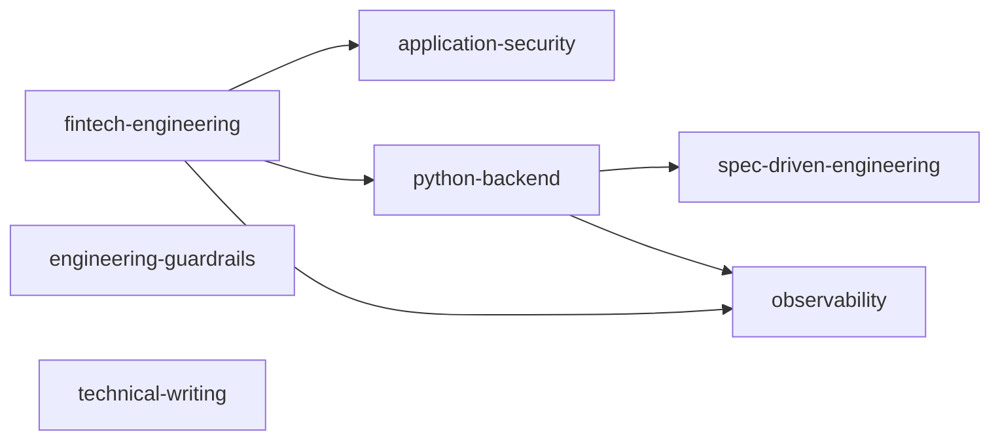

# Architecture

How this repository is organized, how its parts fit together, and why. This is the design reference; [README.md](../README.md) lists what is installed today.

## Capability types

| Type | Answers | Lives in | Format |
|---|---|---|---|
| **Skill** | *How* to do a task | `plugins/<profile>/skills/<name>/SKILL.md` | [skill-anatomy.md](skill-anatomy.md) |
| **Agent** | *Who* does it: role, boundaries, deliverable | `plugins/<profile>/agents/<name>.md` | [agent-anatomy.md](agent-anatomy.md) |
| **Hook** | *Which* operations are allowed, blocked or flagged, and *when* | `plugins/guardrails/` | [hook-anatomy.md](hook-anatomy.md) |
| **Workflow** | *In what order*, with which gates and approvals | Software Factory: `factory-init/assets/factory/workflows/` | § Workflows |
| **Reference** | Reusable knowledge a skill loads on demand | `<skill>/references/*.md` | linked from `SKILL.md` |
| **Script** | Deterministic operations and checks, independent of model judgment | `<skill>/scripts/`, `scripts/` (repo tooling) | executable, documented usage |
| **Eval** | Whether a skill or agent behaves as intended | `plugins/<profile>/evals/<suite>/<case>/` | § Evaluations |

The separation is strict. Judgment ("does this log earn its place?") is a skill and an agent. Pattern facts ("this logger call contains `authorization`") are hooks. Ordering and approval are workflows.

## Distribution: one marketplace, several plugins

The repo root is a Claude Code marketplace (`.claude-plugin/marketplace.json`). Each `plugins/<profile>/` directory is a self-contained plugin, so a project installs only the profiles it needs and pays the always-on context cost only for those.



Arrows are `dependencies` in `plugin.json`. Installing a plugin installs what it depends on.

| Plugin | Purpose | Status |
|---|---|---|
| spec-driven-engineering | Software Factory (11 workflows), product discovery, PRD analysis, decomposition, acceptance criteria, traceability, planning, loop and context engineering, TDD, debugging, git | 13 skills, 5 agents, PRD eval suite |
| technical-writing | Engineering blog pipeline | 4 skills |
| observability | Logging, tracing, redaction, observability design and review | 5 skills, 1 agent, observability eval suite |
| python-backend | Python, Django, FastAPI, APIs, databases, migrations, MySQL, Redis, distributed systems, messaging, performance | 11 skills, 2 agents |
| application-security | Backend application security | 1 skill, 1 agent, security eval suite |
| fintech-engineering | Data integrity, money, credit scoring and eligibility, risk decisions, authorization, auditability, reliability | 7 skills, 2 agents, fintech eval suite |
| engineering-guardrails | Deterministic hooks | 18 hooks, 92 unit tests |

**Why per-directory plugins.** Install testing in an isolated config showed that several plugins sourced from the repo root each load *every* agent through the default `agents/` scan, and that explicit component path lists were not picked up. Per-directory plugins using only default directories (`skills/`, `agents/`) load exactly their own components. A consequence: installed plugins can't read files outside their own directory, so references live with the skill that uses them, not in a shared top-level folder.

## Workflows

Multi-stage engineering processes (feature development, PRD-to-implementation, migrations, incidents, reviews) are **Software Factory workflows**: Markdown procedures with entry conditions, exit conditions, and human approval gates. They are installed into a project as `.factory/workflows/` by `factory-init`, and selected per request by `factory-router`.

They are deliberately not Claude Code's native `workflows/` component. Native workflows are JavaScript orchestration scripts that can't pause for human input mid-run, so they can't host approval gates. A native workflow may still be used *inside* a factory step for a large fan-out task (a codebase-wide audit), never as the gated process itself.

Rules:
- Workflow files stay project-agnostic. They name skills and agents as optional accelerators ("if the `observability-engineering` skill is available, apply it"), so the factory works without any plugin installed.
- Every workflow states: purpose, entry conditions, inputs, outputs, steps, quality gates, exit conditions, human approval required.
- A new workflow is wired into `factory-router` (routing table), `CLAUDE_TEMPLATE.md` (§ 6.1 and repository map), the factory `README.md`, and `verify_factory.sh` (required files) in the same change.

## Project state

State lives in the project, not in conversation history, using the Software Factory's existing artifacts. Nothing here adds a parallel state system.

| Concern | Artifact |
|---|---|
| Source documents (original PRD) | `product/sources/` |
| Analysis of a source document | `product/analysis/` |
| Requirements with stable ids (FR, NFR, BR, Q) | `product/PRD.md`, `product/FEATURES.md` (F-xx) |
| Feature contract (AC-n) | `specs/<F-ID>-<slug>/SPEC.md` |
| Design, including failure scenarios and the observability plan | `specs/<F-ID>-<slug>/DESIGN.md` |
| Plan, progress, in-flight decisions | `tasks/<F-ID>-<slug>.md` |
| Verification evidence | `tasks/reports/<F-ID>-<slug>.md` |
| Session resume point and handoff | `tasks/STATUS.md` |
| Significant decisions | `engineering/adr/NNNN-<slug>.md` |

## Evaluations

Evals use Claude Code's native `claude plugin eval` format, run against a plugin directory. The runner only finds cases under the plugin itself (`--eval-dir` can't leave it), so suites live in each plugin:

```
plugins/<profile>/evals/<suite>/<case>/
  prompt.md            frontmatter: runs, max_turns, allowed_tools, tags; body: the user's request
  case.yaml            optional: scaffold_script / add_dirs for fixtures
  graders/<name>.md    one check per file
```

Each case encodes four things:

| Element | Grader |
|---|---|
| Expected findings | `llm` rubric with concrete PASS / FAIL conditions |
| Required behavior (the skill fired) | `tool_used` on `Skill` with `input_match` on the skill name |
| Forbidden behavior | `regex` with `match: not_contains`, or `tool_used` with `min: 0, max: 0` |
| Pass/fail criteria | the grader set and weights |

Suites include **negative cases**: prompts where a skill must *not* trigger, or code that is already correct and must not be flagged. They measure false positives as well as false negatives. `plugins/*/evals/results/` is git-ignored. Deterministic components (hooks, scripts) are covered by unit tests instead, which are cheaper and exact.

## Installation layers

| Layer | Owner | Location | Committed here? |
|---|---|---|---|
| Reusable capabilities | this repo | `plugins/` | Yes |
| Personal Claude Code configuration | the user | `~/.claude/` (settings, personal agents) | No |
| Project configuration | each project | `<project>/.claude/settings.json`, `<project>/.claude/guardrails.json` | No (lives in the project) |
| Project engineering state | each project | `.factory/`, `product/`, `engineering/`, `specs/`, `tasks/` | No (lives in the project) |

Never commit credentials, tokens, production configuration, or employer-confidential information to this repo.
