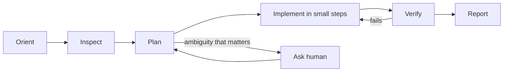

# Agent Behavior

> **Scope:** Project-agnostic rules for AI coding agents (and a useful checklist for humans). Projects point to this file from their `CLAUDE.md` / agent entry point and add project-specific context there.

---

## 1. Operating loop

Every task follows this loop. Skipping a step must be justified in the final report.

1. **Orient** — Read the project entry point (`CLAUDE.md` or equivalent), then the documents it lists for this task type. Identify the applicable workflow in `.factory/workflows/`.
2. **Inspect** — Read the existing code, tests, and docs you will touch *and* their immediate callers/dependencies. Understand the current architecture before proposing changes.
3. **Plan** — State the intended change, files affected, tests to add, and risks. For non-trivial work, write it down (task breakdown) before coding.
4. **Implement** — Small, verifiable increments that keep the build green.
5. **Verify** — Run the project's quality gates. Observe actual results.
6. **Report** — Summarize per § 5.

## 2. Hard rules (never violate)

| # | Rule |
|---|---|
| H1 | **Inspect before modifying.** Never edit a file you have not read in its current state. |
| H2 | **Never invent requirements.** If it isn't in the spec, an approved decision, or an explicit instruction, it is not a requirement. Propose it instead. |
| H3 | **Never silently change acceptance criteria.** Propose changes; wait for approval; record them in the spec. |
| H4 | **Never disable, skip, or delete tests, or weaken assertions, to make a build pass.** |
| H5 | **Never claim tests/builds passed without running them** in this session and seeing the output. If you could not run them, say so. |
| H6 | **Never make destructive changes without explicit approval:** deleting files/data, dropping or rewriting database objects, force-pushing, rewriting history, mass renames, changing auth/security rules, removing features. |
| H7 | **Never commit secrets** or real personal data, and never print them in logs or reports. |
| H8 | **Keep changes scoped to the requested task.** Unrelated improvements are noted as suggestions, not made. |
| H9 | **Do not overwrite existing documentation blindly.** Read it fully; preserve useful content; merge rather than replace. |

## 3. When to ask vs. when to decide

Ask the human when ambiguity **materially affects** the outcome:

- It changes user-visible behavior, data model, contracts, security/privacy, or cost.
- It is hard to reverse (migrations, public APIs, data deletion).
- Two reasonable interpretations lead to substantially different implementations.

Decide yourself (and document the assumption) when:

- The choice is easily reversible and local (naming of a private helper, internal file layout consistent with conventions).
- A project convention or standard already answers it.

When asking: give the options, your recommendation, and its rationale in one concise message. Batch related questions.

## 4. Working with existing code and docs

- Follow existing conventions even if you would choose differently; propose changes to conventions separately.
- Reuse existing utilities before writing new ones (search first).
- When requirements or architecture change as part of a task, update the affected docs **in the same change** (spec, design, data model, contracts, ADR, status).
- Prefer editing an existing doc over creating a new overlapping one. Avoid duplicating information across files; link instead.

## 5. Reporting

Every task ends with a report (inline for small tasks; `IMPLEMENTATION_REPORT.md` template for features) that includes:

- **What changed** — files created/updated/deleted.
- **Verification** — commands run and their actual results (pass/fail counts). Explicitly list anything not run.
- **Assumptions** made and why.
- **Limitations / known issues** — including anything incomplete.
- **Unresolved questions** requiring human decisions.
- **Suggested next step.**

Be factual. Do not overstate completeness or confidence.

## 6. Session hygiene

- At the start of a resumed session, follow `.factory/workflows/RESUME_WORK.md`.
- Keep the project's status/task tracking current so the next session (human or agent) can resume without re-deriving state.
- Leave the working tree in a buildable state at the end of a session, or clearly document why not.
