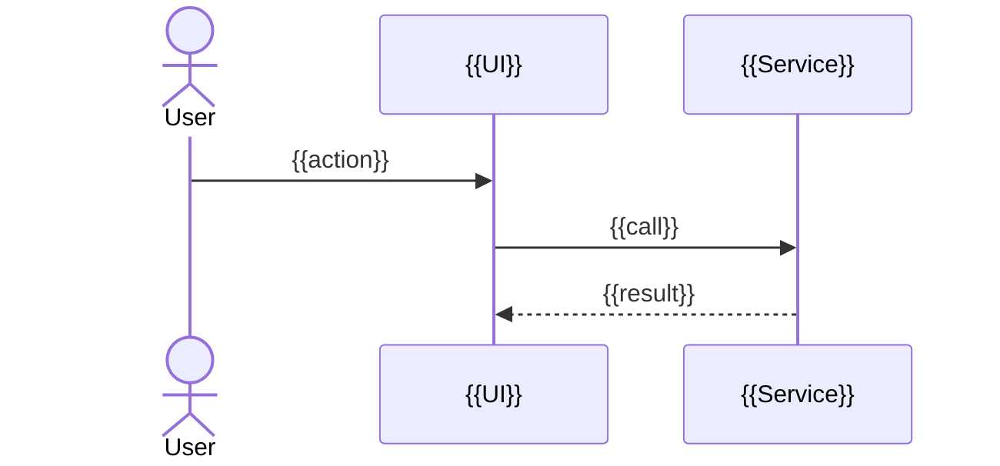

<!--
TEMPLATE: Technical Design
Location convention: specs/<feature-id>-<slug>/DESIGN.md
Purpose: Define HOW a specified feature will be built, consistent with the project's architecture.
Instructions for agents:
- Read the spec, ARCHITECTURE, DATA_MODEL, API_CONTRACTS, SECURITY docs, and the affected code first.
- Every functional requirement in the spec must map to at least one component (§ 3 table).
- Significant decisions → also write an ADR and link it.
- Prefer the simplest design that satisfies the spec; justify any new abstraction or dependency.
-->

# {{Feature ID}} — {{Feature Name}}: Technical Design

| Field | Value |
|---|---|
| Status | {{Draft / Approved / Implemented}} |
| Spec | {{link to SPEC.md}} |
| Related ADRs | {{links}} |
| Last updated | {{YYYY-MM-DD}} |

## 1. Summary
{{2–4 sentences: the approach.}}

## 2. Proposed architecture
<!-- Where this sits in the existing architecture. Diagram encouraged. -->
```mermaid
flowchart LR
  UI[{{UI component}}] --> SVC[{{application service}}] --> DOM[{{domain logic}}]
  SVC --> REPO[{{repository / adapter}}]
```

## 3. Component responsibilities
| Component | Module / path | Responsibility | Requirements covered |
|---|---|---|---|
| {{name}} | {{path}} | {{single responsibility}} | {{FR ids}} |

## 4. Data models
<!-- New/changed entities, fields (with types and units), indexes, invariants, migrations, backward compatibility. -->
{{changes or "No changes"}}

## 5. API / service contracts
<!-- Function signatures, request/response schemas, error codes. -->
```ts
// {{example signature}}
```

## 6. Data flows
<!-- Sequence for the main paths, including failure paths. -->


## 7. Error handling
| Failure | Detection | User-facing behavior | Recovery |
|---|---|---|---|
| {{failure}} | {{how}} | {{message/state}} | {{retry/rollback}} |

## 8. Security and privacy considerations
- **Data accessed/stored:** {{what, classification}}
- **Authorization / isolation:** {{how enforced}}
- **Input validation:** {{where}}
- **Secrets / external services:** {{none / details}}

## 9. Performance considerations
{{expected data volumes, hot paths, caching, bundle impact}}

## 10. Testing strategy
| Level | What is tested | Acceptance criteria covered |
|---|---|---|
| Unit | {{domain functions}} | {{AC ids}} |
| Integration | {{adapters/services}} | {{AC ids}} |
| E2E | {{journeys}} | {{AC ids}} |

## 11. Trade-offs and alternatives considered
| Option | Pros | Cons | Decision |
|---|---|---|---|
| {{option A}} | | | {{Chosen / Rejected}} |

## 12. Rollout and migration
{{feature flags, data migration steps, backward compatibility, rollback plan — or "N/A"}}

## 13. Open questions
| # | Question | Blocks | Status |
|---|---|---|---|
| Q1 | {{question}} | {{what}} | {{Open}} |
