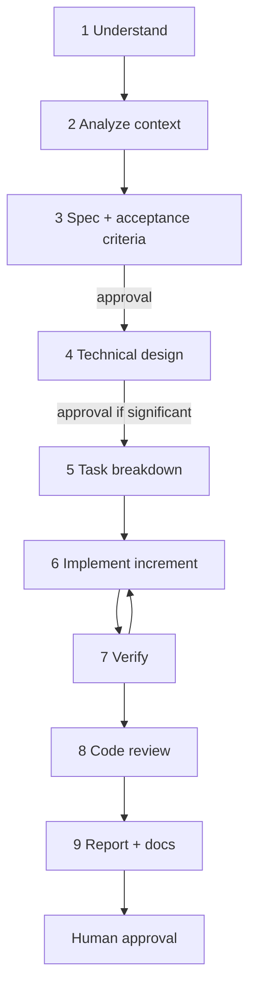

# Workflow: New Feature

> **Scope:** Project-agnostic. Use for any new user-visible capability or meaningful extension of an existing one.

## Purpose

Turn a feature request into working, tested, documented software through explicit specification, design, and incremental implementation.

## Inputs

- The feature request (from a human, roadmap item, or feature catalog entry).
- Project docs: PRD, feature catalog, roadmap, architecture, data model, contracts, security doc.
- Existing code and tests in the affected area.

## Outputs

| Artifact | Template | Conventional location |
|---|---|---|
| Feature specification | `templates/FEATURE_SPEC.md` | `specs/<feature-id>-<slug>/SPEC.md` |
| Technical design | `templates/TECHNICAL_DESIGN.md` | `specs/<feature-id>-<slug>/DESIGN.md` |
| Task breakdown | `templates/TASK_BREAKDOWN.md` | `tasks/<feature-id>-<slug>.md` |
| ADR (if a significant decision is made) | `templates/ARCHITECTURE_DECISION_RECORD.md` | `engineering/adr/NNNN-<slug>.md` |
| Code + tests | — | Source tree |
| Implementation report | `templates/IMPLEMENTATION_REPORT.md` | `tasks/reports/<feature-id>-<slug>.md` |

## Execution steps

1. **Understand the request.** Restate it in one paragraph. Identify the user, the problem, and the expected outcome. List ambiguities.
2. **Analyze existing requirements and architecture.** Read the PRD/feature catalog entry, related specs, architecture, data model, and the code in the affected area. Note constraints and conflicts.
3. **Produce or update the feature specification.** Fill `FEATURE_SPEC.md`: problem, goals, non-goals, user stories, functional/non-functional requirements (with IDs), edge cases, dependencies, open questions.
4. **Define acceptance criteria.** Given/When/Then, each mapped to requirement IDs and to a planned verification (unit/integration/E2E/manual).
   - 🔒 **Gate: spec approval** — human approves the spec before design is finalized when the feature changes product behavior.
5. **Produce the technical design.** Fill `TECHNICAL_DESIGN.md`: architecture, components, data model changes, contracts, data flows, error handling, security, testing strategy, trade-offs. Write an ADR for significant decisions.
6. **Break down into tasks.** Fill `TASK_BREAKDOWN.md`. Each task is small (≈ ≤ half a day), independently verifiable, and keeps the build green. Order: data/domain → services → UI → E2E.
7. **Implement incrementally.** For each task: write/extend tests → implement → run relevant tests → update task status. Do not start the next task with a red build.
8. **Run automated verification.** Run all quality gates (`TESTING_STANDARDS.md` § 10). Record actual results.
9. **Perform code review** per `CODE_REVIEW.md` (self-review first for agents, then human).
10. **Produce the implementation report** and update docs: spec/design to match reality, feature catalog status, data model/contracts/ADRs if changed, project status.

## Quality gates

| Gate | Passes when |
|---|---|
| Spec ready | Every requirement is testable; every acceptance criterion maps to a verification method; open questions are non-blocking or resolved. |
| Design ready | Every functional requirement is addressed by a component; data model and contract changes are explicit; security impact assessed. |
| Increment done | Tests for the increment pass; lint/type-check pass. |
| Feature done | `DEFINITION_OF_DONE.md` fully satisfied. |

## Human approval required

- Spec (when product behavior changes) and any change to acceptance criteria.
- Design decisions recorded as ADRs; data model migrations; contract or security changes.
- Merge to the main branch.
